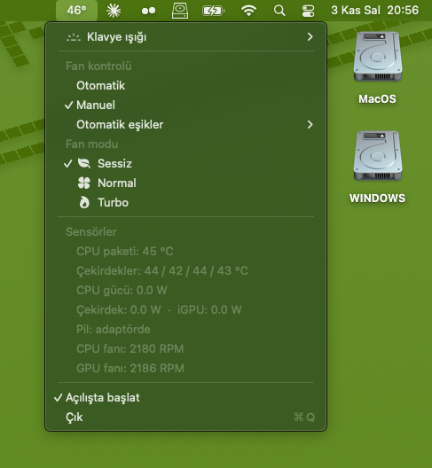
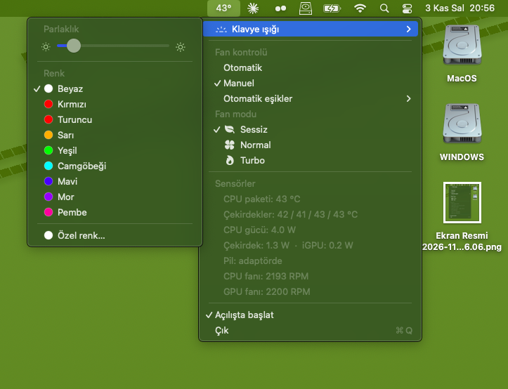
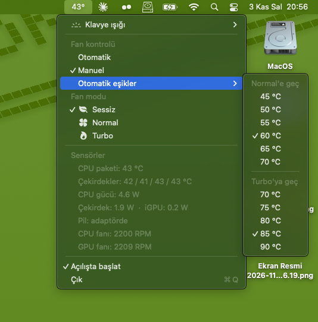

# ASUS TUF Gaming FX506LU — OpenCore Hackintosh (macOS Sequoia)

OpenCore EFI for the **ASUS TUF Gaming FX506LU**, running **macOS Sequoia 15.5 (24F74)** with **native Wi-Fi (no HeliPort)** and **working Intel Bluetooth**.

> **Serial numbers, MLB, SystemUUID and ROM have been removed.** You must generate your own before booting — see [First-time setup](#first-time-setup).

> 🇹🇷 **Türkçe özet:** ASUS TUF FX506LU için OpenCore 1.0.8 EFI. macOS Sequoia 15.5'te yerli Wi-Fi (HeliPort'suz), Intel Bluetooth, ses, ekran parlaklığı, klavye ışığı (parlaklık ve renk) ve tam CPU güç yönetimi çalışıyor. Seri numaraları silindi; kullanmadan önce GenSMBIOS ile kendi `MacBookPro16,3` bilgilerini üretip `PlatformInfo → Generic` altına yazmalısın.

---

## Hardware

| Component | Model | Status |
|---|---|---|
| CPU | Intel Core i5-10300H (Comet Lake-H, 4C/8T) | ✅ Full power management (XCPM), 4.2 GHz all-core at ~45 W |
| iGPU | Intel UHD Graphics 630 | ✅ QE/CI, Metal 3, brightness control |
| dGPU | NVIDIA GeForce GTX 1660 Ti | ❌ Disabled (no macOS driver for Turing) |
| Display | 15.6" 1920×1080 @ 144 Hz | ✅ Native resolution and refresh rate |
| RAM | 16 GB | ✅ |
| SSD (macOS) | InnovationIT 512 GB NVMe (Silicon Motion SM2263) | ✅ |
| Audio | Realtek ALC256 (`layout-id` 17) | ✅ Speakers, internal mic, headphone/line-in |
| Wi-Fi | Intel Wi-Fi 6 AX201 (CNVi, `8086:06F0`) | ✅ Native Wi-Fi via AirportItlwm (menu bar, no HeliPort) |
| Bluetooth | Intel AX201 (`8087:0026`) | ✅ On, pairs devices |
| Ethernet | Realtek RTL8111 | ✅ |
| Touchpad | ELAN I2C (`04F3:307A`) | ✅ Multi-touch gestures (VoodooI2C) |
| Keyboard | PS/2 | ✅ Including Fn brightness keys |
| Webcam | USB2.0 HD UVC WebCam (`13D3:56A2`) | ✅ (image is dark by default; adjust exposure with an app like CameraController) |
| Battery | — | ✅ Percentage and status |
| Sleep / wake | S3 | ✅ Lid sleep, wake via lid/power/keyboard |
| Keyboard backlight | RGB (single zone) | ✅ Brightness with Fn+Up/Down and Control Center (smooth dimming); colour and a brightness slider in the [KBColor](#keyboard-backlight) menu bar app |
| Fan mode | Silent / Normal / Turbo | ✅ Fn+F5 or the [KBColor](#fan-mode) menu, with an on-screen HUD; automatic mode by CPU temperature; fan speeds, temperatures and power draw in the menu |

**SMBIOS:** `MacBookPro16,3`

---

## What's in the EFI

- **OpenCore 1.0.8 RELEASE** (official acidanthera build)
- Graphical boot picker (**OpenCanopy**, theme `Acidanthera\GoldenGate`), only macOS and Windows shown, 5 s timeout
- `SecureBootModel = Default`, **SIP fully enabled** (`csr-active-config = 00000000`)
- `boot-args`: `-wegnoegpu`

### Kexts

| Kext | Version | Notes |
|---|---|---|
| Lilu | 1.7.2 | official |
| VirtualSMC, SMCProcessor, SMCBatteryManager | 1.3.8 | official |
| WhateverGreen | 1.7.1 | official |
| AppleALC | 1.9.8 | official |
| ECEnabler | 1.0.6 | |
| VoodooPS2Controller (+ Keyboard) | 2.3.7 | |
| VoodooI2C (+ GPIO, Services, Input), VoodooI2CHID | 2.9.1 | |
| RealtekRTL8111 | 3.0.4 | |
| **AirportItlwm** | 2.4.0-alpha (`7204c69`) | **[laobamac/itlwm](https://github.com/laobamac/itlwm)** Sequoia build, limited to Darwin 24.2–24.99 |
| BlueToolFixup | 2.7.2 | official (BrcmPatchRAM) |
| IntelBluetoothFirmware | 2.4.0 | official OpenIntelWireless release |
| **IntelBTPatcher** | 2.5.0 | **built from OpenIntelWireless master (`a414375`)** — see below |
| AsusSMC | 1.4.1 | |
| BrightnessKeys | 1.0.3 | |
| USBMap | — | ports mapped for this laptop |
| **KBColor** | 1.1.0 | keyboard backlight colour and fan mode, built from [`KBColor/`](KBColor) |

### ACPI

`SSDT-AWAC`, `SSDT-EC-USBX`, `SSDT-PLUG`, `SSDT-PNLF`, `SSDT-ALS0`, `SSDT-XOSI` (+ `_OSI` rename), `SSDT-dGPU-Off` (+ `_PTS`/`_WAK`/`EC0._REG` renames), `SSDT-WMNB`, `SSDT-KBLT` (keyboard backlight, source in [`KBColor/acpi`](KBColor/acpi/SSDT-KBLT.dsl)), `SSDT-FANM` (fan mode, + `EC0._QB5` rename, [source](KBColor/acpi/SSDT-FANM.dsl), must load after `SSDT-KBLT`).

---

## Key fixes found while building this EFI

### Backlight stays at zero for 3–5 minutes after boot
On macOS 13.4+ the classic `enable-backlight-registers-fix` (`-igfxblr`) leaves the backlight off on Comet Lake. Use **`enable-backlight-registers-alternative-fix`** (`-igfxblt`) instead:

```
DeviceProperties → PciRoot(0x0)/Pci(0x2,0x0)
    enable-backlight-registers-alternative-fix = 01000000
```

### Intel Bluetooth on Sequoia (Address: NULL, toggle keeps spinning)
Two things were required — neither alone was enough:

1. **IntelBTPatcher must support Sequoia.** The official 2.4.0 release is marked as supported only up to Sonoma, so **Lilu silently disables it on Sequoia** (`automatically disabling IntelBTPatcher ... on an unsupported operating system`). The version in this EFI is built from the OpenIntelWireless master branch, which adds Sequoia/Tahoe support and a Sequoia-specific HCI fix.
2. **NVRAM values** (from [aleelmaitro's guide](https://github.com/aleelmaitro/Intel-wireless-Hackintosh-with-AirportItlwm.kext-and-IntelBluetoothFirmware-on-Sequoia-and-newer)), also listed under `NVRAM → Delete` so they are rewritten on every boot:

```
NVRAM → Add → 7C436110-AB2A-4BBB-A880-FE41995C9F82
    bluetoothExternalDongleFailed   <Data> 00
    bluetoothInternalControllerInfo <Data> 0000000000000000000000000000
```

Before the fix, `bluetoothd` logged `Can't obtain vendorID and productID` and `Transport layer initialization failed`, restarting every ~16 s.

### Native Wi-Fi without HeliPort
The official AirportItlwm has no Sequoia build (Apple changed the IO80211 interfaces). The **laobamac** fork provides a Sequoia build that works with the AX201 out of the box. No OCLP root patches and no SIP changes are needed.

### Keyboard backlight
The EC on this laptop exposes the keyboard light in its memory-mapped RAM (`ERM2`, base `0xFE708B00`):

| Offset | Meaning |
|---|---|
| `0x24` | level, 0 = off … 3 = max |
| `0x2B`–`0x2D` | static colour R, G, B |

The EC applies writes immediately. `SSDT-KBLT` implements `\_SB.ATKD.SKBV`, which AsusSMC calls for Fn+Up/Down and the Control Center slider. The EC only has 3 levels, so smooth dimming keeps the level at 3 and scales the colour. The colour set in Windows (Armoury Crate) is read at the first change and kept.

To change the colour from macOS:

1. `KBColor.kext` (in the EFI) matches the `KBCD0001` device from `SSDT-KBLT` and accepts one property per call: `Color` (`0xRRGGBB`), or the fan mode properties described [below](#fan-mode). Anything else is rejected.
2. `KBColor.app` sits in the menu bar, showing the CPU package temperature instead of an icon. Its *Klavye ışığı* submenu has a brightness slider, preset colours and a custom colour picker; there is also a *start at login* option. It reapplies the last colour at login. The slider uses CoreBrightness, the same path as Control Center and Fn+Up/Down, so all three show the same level.

Unzip [`KBColor/KBColor.app.zip`](KBColor/KBColor.app.zip) into `~/Applications`. The app is ad-hoc signed, so macOS blocks it on first launch: open **System Settings → Privacy & Security**, click **Open Anyway** next to KBColor at the bottom and confirm (once). On Sequoia, right-click → **Open** no longer bypasses this. Or build it yourself with `KBColor/build-app.sh`. Building the kext needs Xcode and a [MacKernelSDK](https://github.com/acidanthera/MacKernelSDK) checkout: `MACKERNELSDK=/path/to/MacKernelSDK KBColor/build-kext.sh`.

Lighting effects (breathing, colour cycle) are not supported yet.

### Fan mode

The WMI fan boost call Armoury Crate uses (`DEVS 0x00110018` → `SFBM`) is empty in this DSDT. The mode is kept by the EC:

| EC RAM | Field | Values |
|---|---|---|
| `ERAM` (`0xFE708300`) + `0x06` | `EC0.FNGM` | 0 = Normal, 1 = Turbo, 2 = Silent |

`EC0._QDD` updates DPTF (`ODV0`) and NVIDIA Dynamic Boost for a mode change. `SSDT-FANM` adds `GFAN` / `SFAN` / `GRPM` to `\_SB.KBCD`: `SFAN` only writes `FNGM`, which the EC applies by itself (`_QDD` is not called: it notifies DPTF's `IETM`, which is missing on macOS, and the error aborted the caller); `GRPM` returns fan speed as `0x20E6DA / EC0.FRMS` (CPU) or `FRS2` (GPU), the same formula as the DSTS `0x00110013` / `0x00110014` handlers.

Fn+F5 does not change the mode by itself: the EC raises query `0xB5`, and `_QB5` queues ATKD event `0xAE` for Armoury Crate. That queue is shared with AsusSMC, so instead of listening to it, `_QB5` is renamed to `XQB5` and `SSDT-FANM` provides a new `_QB5` that, on macOS, steps Normal → Turbo → Silent and sends `Notify (KBCD, 0x80)`. Other systems still get the original.

`KBColor.kext` accepts a `FanMode` property (0–2) and `ReadFanMode`, which publishes `FanMode`, `CPUFanRPM` and `GPUFanRPM`. On the `0x80` notification it sends `kIOMessageServicePropertyChange`. The menu bar app lists Silent / Normal / Turbo with the current mode ticked and the fan speeds refreshed every second while the menu is open, and shows a HUD like the volume one after every change.

<p>
  
  
  
</p>

The firmware has no manual fan control: the fan curve / manual fan DSTS IDs (`0x00110021`–`0x00110027`) all return "unsupported" and `SFNM` is empty, so the three EC curves are all there is. *Automatic* control in the app switches between them by CPU package temperature (SMC `TC0P`, smoothed over a few samples): Silent below the lower threshold, Turbo from the upper one, Normal in between, stepping down only 5 °C below a threshold and at most every 10 s. Thresholds are set from the menu (default 60 °C / 80 °C). Picking a mode by hand or pressing Fn+F5 switches back to manual.

The *Sensörler* section shows, refreshed every second while the menu is open: CPU package and per-core temperature (`TC0P`, `TC1C`–`TC4C`), CPU package / core / iGPU power (`PCPR`, `PCPC`, `PCPG`, from SMCProcessor), battery power from `B0AC` × `B0AV` (SMCBatteryManager) and both fan speeds. With the NVIDIA EFI and the [nullmoth driver](https://github.com/nullmoth/nvidia-macos-driver) loaded, it also shows the GTX 1660 Ti temperature (`Temperature(C)` from `NVAccel`'s `PerformanceStatistics`); without the driver the row is hidden.

macOS has no DPTF driver, so the mode changes the EC fan curve but not the CPU power limits that Windows applies per mode.

---

## Known issues

- **Wi-Fi sometimes joins 2.4 GHz instead of 5 GHz** when the same SSID is on both bands (open issue in the laobamac fork). Toggling Wi-Fi off/on usually fixes it; separate SSIDs per band fix it permanently.
- **WPA3-only networks and AirDrop/AWDL** are not supported by the Wi-Fi driver. Wi-Fi 6 (802.11ax) is off by default (`itlwm_he=1` to try it).
- **Sleep takes ~30 s to start**: `wifip2pd` times out waiting for AWDL. Harmless.
- **No audio after a warm restart from Windows.** The Windows Realtek driver leaves the codec in a state macOS doesn't reset. Shut down instead of restarting (with Windows Fast Startup disabled).
- **Clock is 3 hours off right after boot** if Windows keeps the RTC in local time. Set `RealTimeIsUniversal = 1` in Windows to fix.
- Occasional **kernel panics in AppleHDA during early boot** were seen during development (`element modified after free`). They stopped after removing NVMeFix, which is no longer in this EFI.

---

## First-time setup

1. **Generate your own SMBIOS** with [GenSMBIOS](https://github.com/corpnewt/GenSMBIOS) for `MacBookPro16,3` and fill in:
   - `PlatformInfo → Generic → SystemSerialNumber`
   - `PlatformInfo → Generic → MLB`
   - `PlatformInfo → Generic → SystemUUID`
   - `PlatformInfo → Generic → ROM` (6 bytes — e.g. your Wi-Fi or Ethernet MAC address without colons)
   
   Check the serial on Apple's coverage page — it should be **invalid** (not a real Mac's serial).
2. BIOS: disable Secure Boot, enable AHCI, disable Fast Boot.
3. Copy the `EFI` folder to the EFI partition of a USB stick and boot from it. Do a **Reset NVRAM** once from the picker.
4. In Windows, disable **Fast Startup** (helps both audio and Bluetooth after switching OS).

> `EFI/BOOT/.contentVisibility` (containing `Disabled`) hides this OpenCore's own "EFI" entry from the picker. Remove it if you want to see the entry.

---

## Credits

[Acidanthera](https://github.com/acidanthera) (OpenCore, Lilu, VirtualSMC, WhateverGreen, AppleALC, BrcmPatchRAM, VoodooPS2) · [OpenIntelWireless](https://github.com/OpenIntelWireless) (itlwm, IntelBluetoothFirmware) · [laobamac](https://github.com/laobamac/itlwm) (AirportItlwm Sequoia/Tahoe fork) · [VoodooI2C](https://github.com/VoodooI2C/VoodooI2C) · [hieplpvip](https://github.com/hieplpvip/AsusSMC) (AsusSMC) · [1Revenger1](https://github.com/1Revenger1/ECEnabler) (ECEnabler) · [Mieze](https://github.com/Mieze/RTL8111_driver_for_OS_X) (RealtekRTL8111) · [aleelmaitro](https://github.com/aleelmaitro/Intel-wireless-Hackintosh-with-AirportItlwm.kext-and-IntelBluetoothFirmware-on-Sequoia-and-newer) (Bluetooth NVRAM values)

Each component is distributed under its own license (mostly BSD-3-Clause and GPL-2.0). This repository only collects them in a working configuration.

**Use at your own risk.** Always keep a working EFI on a separate USB stick before changing anything.
